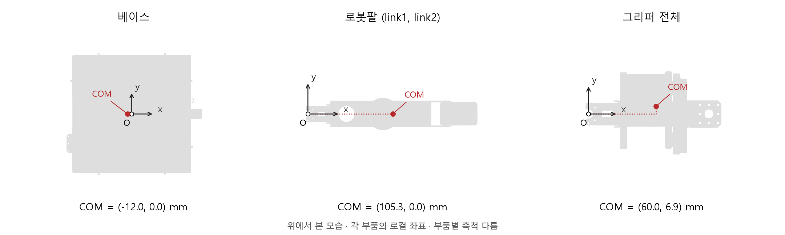

# 질량·관성모멘트·무게중심

측정/추정 기록: **2026-09-22**. 현재 +X 전방 URDF에서 사용하는 값의 출처와 계산 방법을 정리합니다. 질량 단위는 kg, 계산 좌표는 m, 관성은 kg·m²입니다. 표와 다이어그램의 COM 좌표는 mm로 표시하며 0.1mm 단위로 반올림합니다. 계산식과 JSON 원본은 정밀도를 유지합니다.

## 1. 좌표계와 기준축

- +X: 현재 회전축에서 다음 회전축을 향하는 링크 길이 방향. 그리퍼는 접근 방향.
- +Y: 좌측, +Z: 위쪽. 오른손 좌표계이며 양의 Z 회전은 그림에서 반시계 방향.
- 팔 COM은 각 팔의 시작 관절 `joint1`, `joint2` 기준입니다. 베이스 COM은 `base_link` 원점 기준입니다.
- 그리퍼 합산 COM은 `gripper_joint` 기준. `tool0`도 현재 그리퍼 회전축에 있으며 실제 파지 TCP와 구분합니다.
- `joint1` 위치는 베이스 기준 $(190.250,-0.250,0)$mm. `joint2`, `gripper_joint`는 각각 앞 링크 기준 $(199.021,0,0)$mm입니다.
- 각 링크의 로컬 COM을 바로 더하지 않습니다. 먼저 관절 자세를 이용해 같은 기준 좌표계로 변환해야 합니다.

$$
\mathbf c_i^B=\mathbf p_i^B+R_i^B\mathbf c_i^i,\qquad
M=\sum_i m_i,\qquad
\mathbf c^B=\frac{1}{M}\sum_i m_i\mathbf c_i^B
$$

## 2. 관성과 평행축 정리

COM 기준 전체 관성텐서는 다음과 같습니다. URDF의 `ixy`, `ixz`, `iyz`는 이 행렬의 **부호를 포함한 비대각 성분**입니다.

$$
\mathbf I_C=\int\left[(\mathbf s^T\mathbf s)\mathbf 1-\mathbf s\mathbf s^T\right]dm,\qquad \mathbf s=\mathbf r-\mathbf c
$$

$$
I_{zz,C}=\int(s_x^2+s_y^2)dm,\qquad I_{xy,C}=-\int s_xs_y\,dm
$$

조립체 COM을 $\mathbf c$로 두면 부품별 관성을 회전하고 평행축 이동한 뒤 합산합니다.

$$
\mathbf I_C^{\mathrm{assembly}}=\sum_i\left[R_i\mathbf I_{C_i}^i R_i^T+m_i\left((\mathbf d_i^T\mathbf d_i)\mathbf 1-\mathbf d_i\mathbf d_i^T\right)\right],\qquad \mathbf d_i=\mathbf c_i-\mathbf c
$$

평면 모델에서는 $I_{zz,C}=I_{zz,O}-m(c_x^2+c_y^2)$입니다. 단, $I_{zz,O}$가 동일 물체의 고정축 관성일 때의 관계이며, COM이 어긋난 현수 실험의 운동 결합 오차를 이 식만으로 제거할 수 있다는 의미는 아닙니다.

## 3. 베이스 — 균형추 제거

측정 시 베이스의 현수 중심을 맞췄으며, 원점에서 현재 +X 방향 0.200m에 0.710kg 추를 부착했습니다. 추를 포함한 질량은 12.550kg, 측정 중심축 관성은 0.264488kg·m²입니다. 추 자체 관성은 정보가 없어 점질량으로 근사합니다.

$$
m_b=12.550-0.710=11.840
$$

$$
\mathbf c_{b,xy}=-\frac{m_w}{m_b}\mathbf r_{w,xy}=(-0.01199324324,0)\ \mathrm m
$$

$$
I_{zz,O,b}=0.264488-0.710(0.200)^2=0.236088
$$

$$
I_{zz,C,b}=0.236088-11.840(0.01199324324)^2=0.23438495946\ \mathrm{kg\,m^2}
$$

베이스 Z COM은 기존 STL 박스 중심 추정값 211.9mm입니다. Ixx/Iyy와 곱관성도 측정값이 아니라 기존 근사입니다.

## 4. 로봇팔 — 이중현수 측정과 COM 추정

$A=0.120$m, $B=0.215$m는 각 현수점 쌍의 **전체 간격**, $L=0.810$m는 줄 길이, $m=0.570$kg입니다. 동일 길이의 줄, 대칭 현수, 작은 비틀림 진동을 가정합니다.

$$
h=\sqrt{L^2-((A-B)/2)^2}=0.808606054\ \mathrm m
$$

$$
I_{zz,O}=\frac{m g A B T^2}{16\pi^2h},\qquad g=9.80665\ \mathrm{m/s^2}
$$

6개 영상의 **영상별 평균주기**에 MAD robust z > 2.5 기준을 적용해 2개를 제외했습니다. 나머지 4개 값의 평균과 표본 표준편차입니다. 관성은 영상별 $T_i^2$로 계산한 후 평균했습니다.

| 항목 | 평균 | 표본 표준편차 |
| --- | ---: | ---: |
| 주기 (s) | 0.933827845 | 0.000662859 |
| Izz (kg·m²) | 0.000984900424 | 0.000001397791 |

표준편차는 영상 간 반복성입니다. 치수 오차, 현수 정렬 오차 등의 체계오차를 포함한 전체 측정 불확도는 아닙니다.

COM은 XM430 모터 82g을 외형 내부에 균일 분포시키고, 나머지 488g을 철 형상 부피에 비례하여 배분했습니다. 에어베어링 질량은 무시했습니다. 이 가정으로 얻은 COM은 $(105.3,0.0,99.4)$mm입니다.

현수점을 거의 STL 양 끝으로 가정한 중앙은 현재 X=103.875mm이며 COM과 약 1.402mm 차이납니다. 실제 현수점 위치는 정밀 측정되지 않았습니다. 사용자가 이 차이를 수용하여 **측정 Izz를 COM 기준 적용값으로 그대로 유지**했습니다. 같은 부품 1개 값 570g을 link1과 link2에 각각 적용합니다.

## 5. 그리퍼 — STL 부피 기반 근사

전체 실측 질량 160g을 **XM430 82g + 나머지 78g**으로 나눴습니다. 모터는 CAD 주 외형 내부에 균일 분포시키고, 나머지 비모터 형상은 PLA 중심의 동일 유효밀도로 근사했습니다. 소형 하드웨어도 이 배분에 포함되며, 모터 중복 부속 형상은 제외했습니다.

$$
\rho_{\mathrm{eff}}=\frac{0.160-0.082}{\sum_jV_j},\qquad m_j=\rho_{\mathrm{eff}}V_j,\qquad \mathbf c=\frac{\sum_jm_j\mathbf c_j}{\sum_jm_j}
$$

비모터 체적은 84.342880cm³, 유효밀도는 924.796496kg/m³입니다. 이 밀도는 총질량을 맞추기 위한 값이며 PLA 재료 자체의 실측 밀도가 아닙니다. 인필, 부품별 밀도 및 모터 내부 질량 분포에 따른 오차가 있습니다. 계산용 메시에서 열린 판 두 개의 평면 경계만 닫았고, 원본 STL은 수정하지 않았습니다.

아래 COM은 **각 링크 로컬 프레임** 기준입니다. 핑거 로컬 COM을 본체 프레임으로 바꾸려면 `grasp_mount`의 $(75,0,113.216)$mm 이동과 핑거 Z 이동을 적용합니다.

| 링크 | 질량 (kg) | COM x (mm) | COM y (mm) | COM z (mm) | COM Izz (kg·m²) |
| --- | ---: | ---: | ---: | ---: | ---: |
| `gripper_link` | 0.121439745 | 52.5 | 8.7 | 111.2 | 0.000059630999 |
| `upper_finger` | 0.020224693 | 8.6 | 15.5 | 16.9 | 0.000004486516 |
| `lower_finger` | 0.018335562 | 9.0 | -14.7 | -10.4 | 0.000004250950 |

합산하면 질량은 0.160kg, $q=0$에서 그리퍼 회전축 기준 COM은 $(60.0,6.9,112.6)$mm이고, 그 COM 기준 Izz는 **0.000107530015kg·m²**입니다. 합산값을 본체에 다시 넣지 않고 URDF의 본체·상부 핑거·하부 핑거 세 링크에 분배했습니다.

현재 핑거는 Z축으로만 움직이므로 개폐 시 전체 XY COM과 Izz는 변하지 않습니다. Z COM과 나머지 관성 성분은 변합니다.

## 6. +Y 전방에서 +X 전방으로 변환

$$
R=\begin{bmatrix}0&1&0\\-1&0&0\\0&0&1\end{bmatrix},\qquad
\mathbf p_{\mathrm{new}}=R\mathbf p_{\mathrm{old}},\qquad
\mathbf I_{\mathrm{new}}=R\mathbf I_{\mathrm{old}}R^T
$$

즉 $(x,y,z)\rightarrow(y,-x,z)$입니다. 관절 위치·COM·관성텐서를 함께 변환했습니다. 원본 STL은 보존하고 URDF `visual/collision origin`에 `rpy="0 0 -1.5707963267948966"`을 지정합니다. 질량과 Izz는 유지되고 Ixx/Iyy는 교환되며 곱관성도 회전됩니다.

URDF의 `inertial origin`은 해당 링크 COM이고 `inertia`는 그 COM 기준 텐서입니다. 전체 수치는 [mass_properties.json](assets/mass_properties.json)에 기록했습니다. JSON의 그리퍼 합산 항목은 참고용으로, `links`와 함께 질량을 더하면 중복됩니다.

## 7. 전체 모델과 FSW 설정

$$
M=11.840+2(0.570)+0.160=13.140\ \mathrm{kg}
$$

전체 COM과 Izz는 각 링크를 현재 관절 자세에서 공통 좌표계로 변환한 후 1~2절의 식으로 구합니다. **부품별 Izz의 단순 합은 전체 COM 기준 관성이 아닙니다.** 팔이 움직이면 부품 간 거리가 바뀌므로 전체 COM과 관성도 바뀝니다.

[FSW SIL 질량 설정](../../config/vehicle/mass_properties.yaml)에 전체 질량 **13.140kg**, 전체 COM 기준 **Izz=0.481692382889kg·m²**를 적용했습니다. 기준 자세는 `joint1=joint2=gripper_joint=0 rad`, `finger_slide=0 m`이며 팔을 +X로 편 상태로 고정한 단일 강체 근사입니다.

이 자세의 전체 COM은 `base_link` 기준 **(31.4, 0.1, 200.9)mm**입니다. 부품별 COM을 관절 원점으로 이동한 뒤 질량 가중 평균과 평행축 정리로 합산했습니다. [JSON의 assembly_reference_pose](assets/mass_properties.json)에 계산용 정밀도를 보존했습니다.

현재 SIL은 질량과 Izz 두 스칼라를 사용하며 URDF를 직접 읽지 않습니다. 따라서 팔이 움직일 때의 COM/관성 변화, 관절 운동 반작용, 센서·추력기 좌표에서 전체 COM까지의 기준점/렌치 이동을 이번 설정 변경만으로 모델링하지 않습니다. 팔 자세나 물리 모델 범위가 바뀌면 해당 기준에 맞게 다시 계산해야 합니다.

원본 URDF에는 여섯 물리 링크 모두 `inertial/origin xyz`로 로컬 COM, `mass`로 질량, `inertia`로 COM 기준 텐서가 포함되어 있습니다. 이 설정은 본체 원점과 COM이 같다는 뜻이 아닙니다.

## 자료와 검증 범위

- [수치 스냅샷: 부품별 COM·전체 관성텐서](assets/mass_properties.json)
- [PNG 다이어그램](assets/mass_properties_top_view.png) / [SVG 다이어그램](assets/mass_properties_top_view.svg)
- 기준 자료: FSS 질량특성 측정장치 매뉴얼의 bifilar 식, 영상 6개 중 채택 4개의 주기, 사용자 질량/치수 입력, 최종 URDF 및 STL 적분 결과.
- 질량 합, 추 제거와 평행축 계산, 좌표 변환, 관성 양정치와 주관성 삼각 부등식을 확인했습니다. 세 관절 자세에서 URDF의 변환 전후 형상·COM·텐서 동등성도 확인했습니다.
- 베이스/팔 비평면 관성 및 일부 COM, 그리퍼 관성은 위 가정을 사용한 추정값입니다. 실제 물리엔진 동역학 실행 검증은 이 기록에 포함되지 않습니다.
