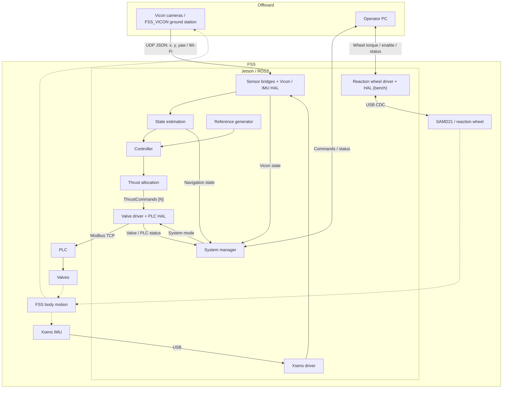

# 001. fss_interfaces — 메시지 및 서비스 정의

**상태: 완료**
**패키지 유형:** `ament_cmake` (rosidl 코드 생성)

## 개요

FSS 비행 소프트웨어에서 사용하는 모든 커스텀 ROS2 메시지(msg)와 서비스(srv)를 정의한다.
`rosidl_generate_interfaces`를 통해 Python/C++ 바인딩이 자동 생성된다.

## 시스템 흐름

실선은 데이터·명령 전달, 점선은 물리 운동과 측정 관계다.
유도·제어·추력 할당은 `fss_gnc` 안의 기능이며 각각 별도 ROS 노드를 뜻하지 않는다.



반응휠은 독립 bench 명령 경로를 사용한다. 현재 GNC의 추력 할당 출력은 밸브 드라이버에 연결된다.

## 메시지 (msg) — 7개

### SpacecraftState

평면 우주선의 전체 상태 벡터.

| 필드 | 타입 | 설명 |
|------|------|------|
| `header` | `std_msgs/Header` | 타임스탬프, 프레임 ID |
| `x`, `y` | `float64` | 테이블 프레임 기준 위치 [m] |
| `theta` | `float64` | 방향각 [rad] |
| `vx`, `vy` | `float64` | 테이블(관성) 프레임 기준 속도 [m/s] |
| `omega` | `float64` | 각속도 [rad/s] |
| `std_x`, `std_y` | `float64` | 위치 추정 1σ [m] (EKF 공분산; 미추정 발행자는 0) |
| `std_theta` | `float64` | 자세 추정 1σ [rad] |

### TrajectoryReference

유도 모듈이 제어기에 전달하는 기준 상태 + 피드포워드.

| 필드 | 타입 | 설명 |
|------|------|------|
| `header` | `std_msgs/Header` | 타임스탬프 |
| `x_ref`, `y_ref`, `theta_ref` | `float64` | 목표 위치/자세 |
| `vx_ref`, `vy_ref`, `omega_ref` | `float64` | 목표 속도 |
| `ax_ff`, `ay_ff`, `alpha_ff` | `float64` | 피드포워드 가속도 |

### ThrustCommands

GNC에서 `/actuators/thrust_commands`로 전달하는 노즐별 목표 추력.

| 필드 | 타입 | 설명 |
|------|------|------|
| `header` | `std_msgs/Header` | 명령 생성 타임스탬프 |
| `thrust_n` | `float64[8]` | 노즐별 목표 추력 [N], 기하 설정의 노즐 순서 |
| `enabled` | `bool[8]` | false인 노즐은 출력 0 |

### ValveCommands

밸브 드라이버가 `/actuators/valve_commands`로 발행하는 HAL 전달 입력.
추력 맵 역변환과 안전 게이팅이 반영되며, SIL 플랜트가 구독한다.

| 필드 | 타입 | 설명 |
|------|------|------|
| `header` | `std_msgs/Header` | 타임스탬프 |
| `duty_cycles` | `float64[8]` | 정규화된 듀티 사이클 (0.0~1.0) |
| `enabled` | `bool[8]` | 밸브별 활성화 플래그 |

### ValveStatus

밸브 드라이버가 발행하는 실제 적용 상태.

| 필드 | 타입 | 설명 |
|------|------|------|
| `header` | `std_msgs/Header` | 타임스탬프 |
| `commanded_duty_cycles` | `float64[8]` | 목표 추력을 역변환한 입력 (안전 게이팅 전) |
| `applied_values` | `float64[8]` | PLC 전송값 (0~4000) |
| `estimated_thrust` | `float64[8]` | 추정 추력 [N] (캘리브레이션 후) |
| `main_valve_open` | `bool` | 메인 밸브(에어베어링) 상태 |
| `modbus_rtt_ms` | `float64` | 최근 Modbus 왕복 시간 [ms] (SimHal은 0.0) |

### SystemMode

시스템 운영 모드.

| 상수 | 값 | 설명 |
|------|----|------|
| `IDLE` | 0 | 대기: 모든 밸브 꺼짐 |
| `PRESSURIZING` | 1 | 가압 중: 에어베어링 활성화 대기 |
| `READY` | 2 | 준비: 에어베어링 활성, GNC 대기 |
| `ACTIVE` | 3 | 활성: GNC 루프 실행 중 |
| `SAFE_HOLD` | 4 | 안전 유지: 정지 유지 모드 |
| `EMERGENCY_STOP` | 5 | 비상 정지: 모든 출력 즉시 차단 |

### SystemHealth

시스템 건강 상태 요약.

| 필드 | 타입 | 설명 |
|------|------|------|
| `navigation_ok` | `bool` | 항법 시스템 정상 여부 |
| `actuators_ok` | `bool` | 액추에이터 시스템 정상 여부 |
| `main_valve_open` | `bool` | 메인 밸브 상태 |
| `navigation_degraded` | `bool` | 항법 성능 저하 (Vicon 장애) |
| `control_loop_rate_hz` | `float64` | 실제 제어 루프 주파수 |
| `navigation_age_sec` | `float64` | 마지막 유효 항법 업데이트 이후 경과 |
| `modbus_rtt_ms` | `float64` | Modbus 왕복 시간 |
| `warnings`, `errors` | `string[]` | 경고/오류 메시지 목록 |

## 서비스 (srv) — 5개

### MainValveControl

에어베어링 메인 밸브 제어.

```
Request:  bool open          # true = 열기, false = 닫기
Response: bool success
          string message
```

### SetGuidanceMode

유도 모드 변경.

```
Request:  uint8 mode         # STATION_KEEP=0, WAYPOINT=1, TRAJECTORY=2, PROXIMITY=3, MANUAL=4
Response: bool success
          string message
```

### SetController

제어기 유형 변경.

```
Request:  string controller_type   # "pid", "lqr" (빈 문자열=리셋)
Response: bool success
          string message
```

### SetSystemMode

시스템 모드 전환 요청.

```
Request:  uint8 requested_mode    # SystemMode 상수 사용
Response: bool success
          uint8 actual_mode       # 실제 전환된 모드
          string message
```

## 빌드

```bash
colcon build --packages-select fss_interfaces
```

## 확인 방법

```bash
ros2 interface show fss_interfaces/msg/SpacecraftState
ros2 interface show fss_interfaces/srv/MainValveControl
ros2 interface list | grep fss_interfaces
```

## 의존성

- `std_msgs` (Header)
- `geometry_msgs`
